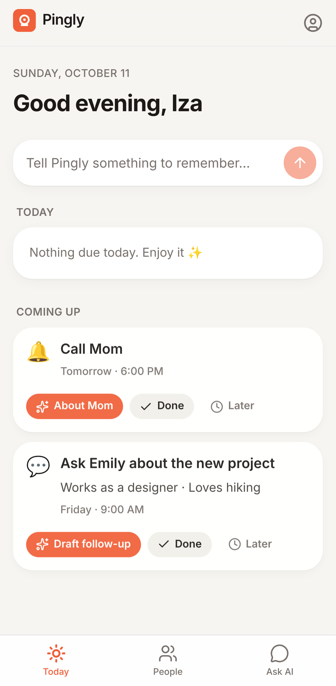
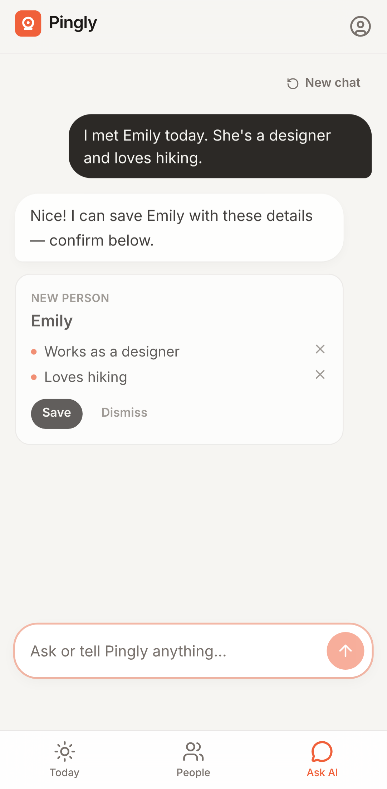
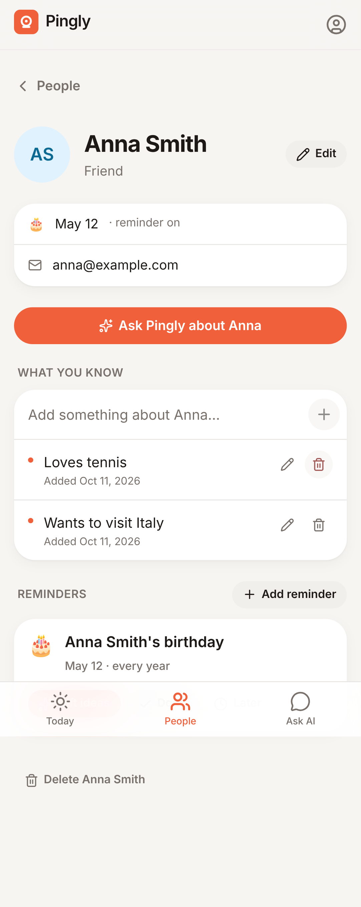

# Pingly

**Never forget the people who matter.**

Pingly is a personal AI memory for the people in your life. Tell it what you learn about someone, and it remembers. It reminds you at the right time and helps you follow through.

| Today | Ask AI | Person |
| --- | --- | --- |
|  |  |  |

## How it works

1. **Remember someone.** Type *"I met Emily today. She's a designer and loves hiking."*
2. **Save useful details.** Pingly shows what it understood as cards. Nothing is saved until you tap **Save**.
3. **Get reminded.** Type *"Remind me to ask Emily about her new project next Friday."* It appears on **Today** and, if email is set up, arrives in your inbox.
4. **Take action.** Tap **Draft follow-up** or **Gift ideas** on a reminder, and Pingly writes it using only what you saved.

The app has three tabs:

- **Today**: what's due now, what's coming up, and a box to tell Pingly something.
- **People**: everyone you've saved, each with memories, upcoming reminders and history.
- **Ask AI**: questions and commands in plain language.

## Tech stack

- **Next.js 16** (App Router, Cache Components, Partial Prefetching) with TypeScript and Tailwind CSS v4.
- **Supabase**: email/password auth, Postgres, and Row Level Security on every table.
- **Anthropic Claude** for AI. It runs server-side only and returns structured output; the default model is `claude-opus-5-5` at low effort, with refusal fallback.
- **Resend** for reminder emails, sent by a server-side scheduler endpoint.

## Run it locally

You need Node 20+ and Docker for the local Supabase stack.

```bash
npm install
npm run db:start              # local Postgres + Auth + mail catcher; applies supabase/migrations
cp .env.example .env.local    # paste the keys printed by db:start
npm run dev                   # http://localhost:3000
```

- Auth emails (confirmation, password reset) go to Mailpit locally: http://127.0.0.1:54324.
- To run the reminder scheduler every minute while developing, run `npm run cron:local` in a second terminal.

## Environment variables

| Variable | Required | Purpose |
| --- | --- | --- |
| `SUPABASE_URL` | yes | Supabase project URL |
| `SUPABASE_PUBLISHABLE_KEY` | yes | Public key; all user requests are limited by RLS |
| `SUPABASE_SECRET_KEY` | yes | **Server-only.** Used by the scheduler and account deletion |
| `APP_URL` | yes | Public app URL, used in auth and reminder emails. Read at runtime |
| `CRON_SECRET` | yes, for email | Shared secret for `/api/cron/reminders` |
| `ANTHROPIC_API_KEY` | for AI | Without it, Ask AI shows a notice; everything else works |
| `PINGLY_AI_MODEL` | no | Model override (default `claude-opus-5-5`) |
| `RESEND_API_KEY`, `REMINDER_EMAIL_FROM` | for email | Without them, reminders appear in the app only, and the job reports that no email was sent |

All variables are read **at runtime**: change them on your host and the next request picks them up, with no rebuild. The `NEXT_PUBLIC_SUPABASE_URL`, `NEXT_PUBLIC_SUPABASE_PUBLISHABLE_KEY` / `*_ANON_KEY` and `SUPABASE_SERVICE_ROLE_KEY` names (e.g. from Supabase's Vercel integration) also work.

### Troubleshooting

Open **`/setup`** on your deployment. Until the Supabase settings are present, every page redirects there. The page lists each missing variable and checks that Supabase is reachable and the database tables exist. Once everything required is in place, it only says "Pingly is set up".

| Symptom | Cause | Fix |
| --- | --- | --- |
| Every page redirects to `/setup` | Supabase URL or key not set | Add the variables listed there |
| `/setup` says "Can't reach Supabase" | Wrong URL, or the project is paused | Check the URL; resume the project in Supabase |
| `/setup` says "tables don't exist yet" | Migrations not applied | `supabase link` then `supabase db push` |
| Log in says "Couldn't reach Pingly's server" | Supabase is down or unreachable from your host | Check `/setup` |

## Reminders and scheduling

- Reminders are stored as absolute times, computed from the user's time zone, which follows their device.
- Birthday reminders repeat every year and fire at 9:00 the morning before the birthday. Feb 29 falls back to Feb 28 in common years.
- **Done** moves a one-time reminder to history. A yearly reminder logs the occurrence and rolls forward to next year.
- **Later** offers: in 3 hours, tomorrow morning, this weekend, next week, or a chosen date. A snoozed reminder is emailed again at its new time.
- The database blocks duplicate reminders: one active birthday reminder per person, and no two active reminders with the same title, person and time.

Scheduling runs on the server, so it doesn't depend on a browser being open. Something must call the endpoint every few minutes:

```
GET /api/cron/reminders
Authorization: Bearer $CRON_SECRET
```

Each run emails reminders that came due in the last 48 hours. Each occurrence is first claimed with a unique row in `reminder_notifications`, so even concurrent runs send it **at most once**. Resend also gets an idempotency key. Failed sends are retried up to 3 times. Reminders are marked sent only after Resend accepts them. If email isn't configured, nothing is claimed, so due reminders still go out once you configure it (within the 48-hour window).

Any of these can be the caller:

- **Supabase pg_cron.** Enable the `pg_cron` and `pg_net` extensions, then run in the SQL editor:
  ```sql
  select cron.schedule('pingly-reminders', '*/5 * * * *', $$
    select net.http_get(
      url := 'https://YOUR_APP_URL/api/cron/reminders',
      headers := jsonb_build_object('Authorization', 'Bearer YOUR_CRON_SECRET')
    );
  $$);
  ```
- **Vercel Cron.** Add a `crons` entry to `vercel.json`. Vercel sends `CRON_SECRET` automatically. Note that the Hobby plan only allows daily crons.
- **Any external scheduler**, such as GitHub Actions or cron-job.org.

## Privacy and security

- Every table has Row Level Security (`user_id = auth.uid()`).
- People, memories and reminders are joined by composite foreign keys `(person_id, user_id)`. A row can never point at another user's person, even through the service role.
- Every page, server action and route re-verifies the session on the server. The proxy only redirects; it is not the security boundary.
- **AI gets the minimum.** The server first finds which saved people the message mentions, and sends only those people's memories and reminders. It never sends the full contact list, and never anyone's email or phone. The model can only reference people it was shown; anything else is dropped.
- **AI never writes.** It proposes changes as cards. The server re-validates each card when you tap Save. A field that differs from what's saved (e.g. a birthday) is shown as *old → new* and requires **Replace**. If the value changed since the suggestion, nothing is overwritten.
- Memories and people can be edited or deleted. **Account → Delete account** removes everything through cascading deletes.
- No analytics, no ads, and nothing is used for training. Under Anthropic’s commercial API terms, API data isn’t used for training by default.
- API keys are server-only, and an AI rate limit is applied per user.

## Tests

```bash
npm run typecheck && npm run lint
npm test            # unit + integration (needs `npm run db:start`)
npm run test:e2e    # production build + Playwright on a mobile viewport
```

- **Unit tests:** time zones and DST, birthdays and Feb 29, Today grouping, people matching, AI proposal validation (made-up people, conflicts, duplicates, past dates), and the email request format.
- **Integration tests** run against real local Supabase:
  - RLS and composite-key isolation between users, plus anonymous access
  - account deletion cascade
  - every write path, including conflict protection, duplicate prevention, and completing yearly reminders
  - the scheduler: sends exactly once, even with concurrent runs; retries; respects opt-out; ignores stale reminders; re-notifies after a snooze; claims nothing when email isn't configured
- **End-to-end tests:** the full remember → save → remind → act workflow, natural-language reminders, Save all, drafts, conflict and ambiguity handling, cross-device sync, user isolation in the UI, password reset by email, account deletion, and the cron endpoint's auth.

The e2e suite runs the real Anthropic SDK against a small local fake of the Messages API (`tests/support/fake-anthropic.mjs`). That fake records each request, so the tests check exactly which personal data was sent to the AI. Integration tests refuse to run against a non-local Supabase.

## Production checklist (needs approval; nothing has been deployed)

1. Create a Supabase project and apply `supabase/migrations` (`supabase link` then `supabase db push`).
2. In Supabase Auth → URL Configuration, set the Site URL to your `APP_URL` and add `APP_URL/auth/confirm` to the redirect URLs.
3. Optional: point the "Confirm signup" and "Reset password" email templates at `{{ .SiteURL }}/auth/confirm?token_hash={{ .TokenHash }}&type=email` (or `type=recovery`), so links work on a different device than the one that requested them.
4. Configure custom SMTP in Supabase for auth emails. The built-in sender is rate-limited.
5. Verify a sending domain in Resend and set `RESEND_API_KEY` and `REMINDER_EMAIL_FROM`.
6. Set every environment variable on your host, and schedule the cron (see above).
